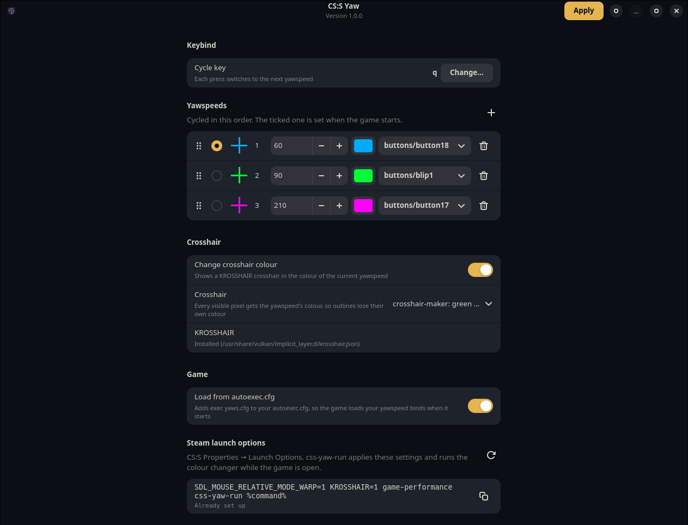

# CS:S Yaw

Cycle `cl_yawspeed` in Counter-Strike: Source with one key, and see which yawspeed is
active from a sound and from your crosshair colour. Made for surf on Linux.

- **Sound:** a short game sound plays when you switch, and only you hear it.
- **Crosshair colour:** a [KROSSHAIR](https://github.com/noahlyk/krosshair) crosshair
  changes colour for each yawspeed.



## What you need

- Linux, and the native Linux version of CS:S on Steam. Steam from your distro's packages
  works. Flatpak Steam doesn't, because `css-yaw-run` can't run inside its sandbox.
- Python 3, GTK 4, libadwaita 1.5 or newer, PyGObject and Pillow. `install.sh` installs
  them if they are missing.
- For the crosshair colours: KROSSHAIR. If it isn't installed, the app can install it for
  you (see below). crosshair-maker is optional.

## Install

```sh
./install.sh
```

Then:

1. Open **CS:S Yaw**, pick your key, yawspeeds, colours and sounds, and press **Apply**.
2. Turn on **Load from autoexec.cfg**, or add `exec yaws.cfg` to your `autoexec.cfg` yourself.
3. Add `css-yaw-run` right before `%command%` in the CS:S launch options. The app shows
   your current launch options with it added, ready to copy. With no other options:

   ```
   css-yaw-run %command%
   ```

   If Steam can't find `css-yaw-run` (it lives in `~/.local/bin`), the app shows the full
   path instead.

To remove the app, run `./install.sh --uninstall` and take `css-yaw-run` out of the
launch options. It asks whether to remove `yaws.cfg` and its `autoexec.cfg` line too.

If you already had a `yaws.cfg` of your own, the app saves it as `yaws.cfg.bak-css-yaw`
before writing its own, and uninstalling puts it back.

## In the app

- **Cycle key:** press any key, mouse button or wheel direction to bind it. If that key is
  already bound to something else, the app tells you what.
- **Yawspeeds:** add, remove or drag them into order. Each one has a crosshair colour and a
  sound, which you can preview from the dropdown. The ticked one is set when the game starts.
- **Change crosshair colour:** turn the colour changing off if you only want the sounds.
- **Crosshair:** the image that gets recoloured. Choose your crosshair-maker crosshair if
  you use it, the built-in plain cross, or any PNG. The crosshairs that come with KROSSHAIR
  are offered in the file picker.
- **KROSSHAIR:** if it isn't installed, **Install** downloads KROSSHAIR 0.2.5 (GPL-3.0,
  x86_64 only) from its GitHub releases into your user folder. No password is needed, and
  nothing is downloaded unless you press it.

If the game is already running when you press Apply, run `exec yaws` in the console.

## How it works

- The app writes `cfg/yaws.cfg`. In it, each press sets the next `cl_yawspeed`, plays its
  sound with `play`, and runs `echo YAW_<speed>`. `con_logfile yaw.log` copies the console
  to a file.
- `css-yaw-run` wraps the game. It rebuilds `yaws.cfg` and the coloured crosshairs from
  your settings, then starts the game with `KROSSHAIR=1` and
  `KROSSHAIR_IMG=~/.config/css-yaw/current.png`. While the game runs, it watches
  `yaw.log` and copies the matching colour over that file on each `YAW_<speed>` line.
  KROSSHAIR reloads the file whenever it changes.

Settings and generated images are stored in `~/.config/css-yaw`.

## Limits

- Recolouring is flat: every visible pixel of the crosshair gets the chosen colour, so
  outlines lose their own colour.
- If another config changes `cl_yawspeed` directly, the colour isn't updated until the
  next press of the cycle key.

## License

[CC0 1.0](LICENSE). Public domain, do what you like. CS:S Yaw ships no third-party files:
it plays sounds straight from your own CS:S install, and KROSSHAIR is only downloaded from
its own releases if you ask for it.
